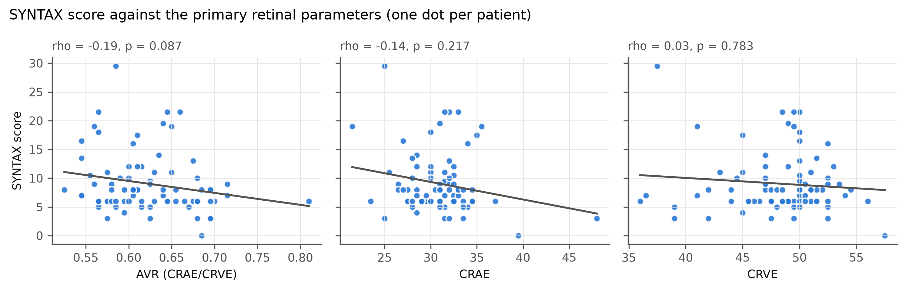
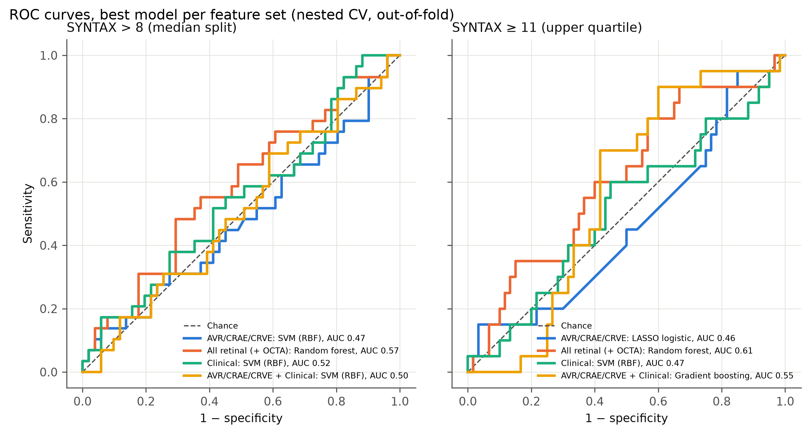
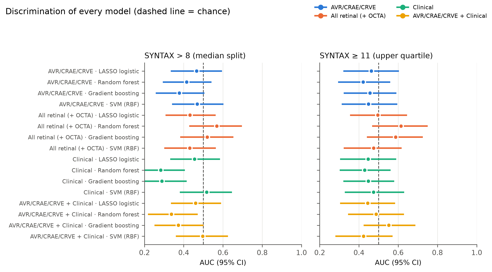
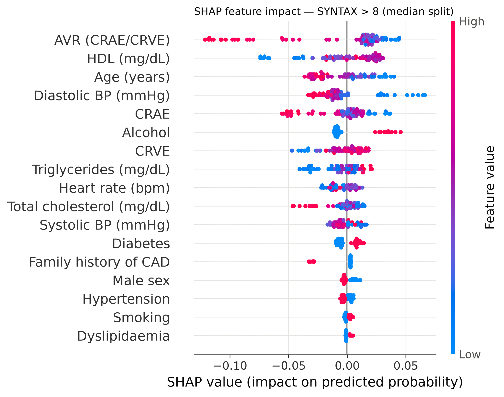
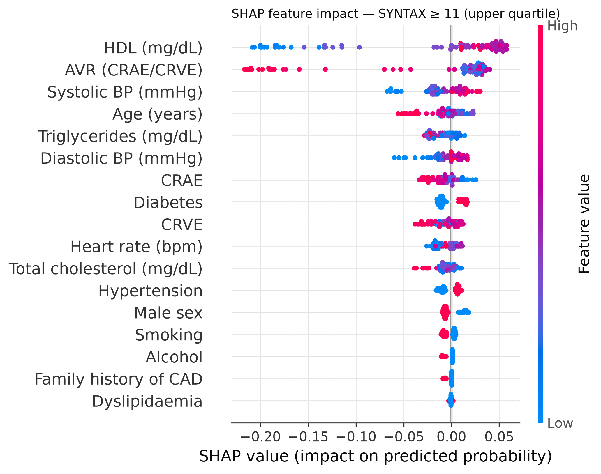

# Retinal microvasculature and ACS severity — AI analysis report

_Generated automatically by `run_analysis.py`. All numbers come from the study workbook._

## 1. Cohort

- 160 eyes from **80 patients**; eye-level retinal parameters were averaged per patient so that each patient contributes one observation.
- SYNTAX score: median 8.0 (IQR 6.0–10.6), range 0–29.5. Only 1 patient(s) exceeded 22, so the conventional low/intermediate/high SYNTAX categories (≤22 / 23–32 / ≥33) could not be used.
- Outcomes modelled: SYNTAX > 8 (median split, n = 29/80), SYNTAX ≥ 11 (upper quartile, n = 20/80); SYNTAX was also modelled as a continuous score.
- Primary predictors: **AVR, CRAE and CRVE**. OCTA parameters and clinical risk factors were analysed as comparison predictor sets.
- ⚠️ Provisional data correction, patient 56: {'SYNTAX': 6.0} (eye rows disagreed; confirm against case record).

## 2. Patient characteristics by SYNTAX group

Continuous variables: median [IQR]; categorical: n (%).

| Variable | SYNTAX ≤ 8 (n=51) | SYNTAX > 8 (n=29) | p | Test |
|---|---|---|---|---|
| CRAE | 31.00 [29.00–33.00] | 31.00 [28.50–32.00] | 0.343 | Mann–Whitney |
| CRVE | 49.00 [46.25–51.00] | 49.50 [47.00–50.50] | 0.752 | Mann–Whitney |
| AVR (CRAE/CRVE) | 0.61 [0.59–0.68] | 0.61 [0.57–0.64] | 0.141 | Mann–Whitney |
| A-V ratio (fundoscopy) | 0.29 [0.29–0.33] | 0.29 [0.25–0.33] | 0.059 | Mann–Whitney |
| FAZ area (mm²) | 0.32 [0.23–0.45] | 0.36 [0.12–0.53] | 0.988 | Mann–Whitney |
| FAZ perimeter (mm) | 3.26 [2.69–3.88] | 3.43 [2.43–4.54] | 0.830 | Mann–Whitney |
| FAZ circularity | 0.38 [0.33–0.42] | 0.33 [0.31–0.39] | 0.039 | Mann–Whitney |
| VD superficial plexus (%) | 27.00 [21.25–33.75] | 29.50 [12.50–35.00] | 0.968 | Mann–Whitney |
| VD deep plexus (%) | 13.50 [6.75–24.50] | 13.00 [2.00–24.00] | 0.548 | Mann–Whitney |
| VD outer retina (%) | 9.00 [3.75–18.50] | 6.00 [2.00–13.50] | 0.193 | Mann–Whitney |
| VD outer retina–CC (%) | 48.00 [42.50–51.50] | 48.00 [35.00–52.00] | 0.660 | Mann–Whitney |
| VD choriocapillaris (%) | 49.00 [35.75–52.50] | 49.50 [23.00–53.00] | 0.892 | Mann–Whitney |
| VD choroid (%) | 50.00 [46.50–51.00] | 51.00 [32.50–53.00] | 0.263 | Mann–Whitney |
| Central foveal thickness (µm) | 229.50 [214.75–237.00] | 230.00 [221.00–238.00] | 0.752 | Mann–Whitney |
| Subfoveal choroidal thickness (µm) | 244.50 [196.00–279.00] | 257.50 [196.50–297.00] | 0.465 | Mann–Whitney |
| Age (years) | 57.00 [48.50–61.50] | 55.00 [47.00–61.00] | 0.437 | Mann–Whitney |
| Male sex | 39 (76%) | 21 (72%) | 0.790 | Fisher |
| Family history of CAD | 6 (12%) | 1 (3%) | 0.412 | Fisher |
| Diabetes | 17 (33%) | 13 (45%) | 0.344 | Fisher |
| Hypertension | 29 (57%) | 15 (52%) | 0.815 | Fisher |
| Dyslipidaemia | 5 (10%) | 5 (17%) | 0.483 | Fisher |
| Smoking | 18 (35%) | 11 (38%) | 0.814 | Fisher |
| Alcohol | 5 (10%) | 7 (24%) | 0.108 | Fisher |
| Heart rate (bpm) | 80.00 [70.00–88.00] | 80.00 [72.00–86.00] | 0.940 | Mann–Whitney |
| Systolic BP (mmHg) | 128.00 [120.00–138.50] | 126.00 [112.00–140.00] | 0.892 | Mann–Whitney |
| Diastolic BP (mmHg) | 78.00 [70.50–86.00] | 78.00 [70.00–84.00] | 0.296 | Mann–Whitney |
| Total cholesterol (mg/dL) | 167.00 [147.00–197.00] | 177.00 [145.00–190.00] | 0.663 | Mann–Whitney |
| Triglycerides (mg/dL) | 113.00 [101.00–133.00] | 113.00 [106.00–134.00] | 0.783 | Mann–Whitney |
| HDL (mg/dL) | 43.00 [40.00–46.00] | 44.50 [41.00–47.00] | 0.339 | Mann–Whitney |

## 3. Correlation of retinal parameters with SYNTAX score

Patient level; q = Benjamini–Hochberg false-discovery-rate-adjusted p across all 15 retinal parameters.

| Retinal parameter | Role | Spearman rho | p (Spearman) | Pearson r | p (Pearson) | q (FDR, Spearman) |
|---|---|---|---|---|---|---|
| CRAE | Primary | -0.140 | 0.217 | -0.210 | 0.062 | 0.797 |
| CRVE | Primary | 0.031 | 0.783 | -0.098 | 0.387 | 0.919 |
| AVR (CRAE/CRVE) | Primary | -0.193 | 0.087 | -0.206 | 0.067 | 0.650 |
| A-V ratio (fundoscopy) | OCTA / other | -0.135 | 0.231 | -0.071 | 0.529 | 0.797 |
| FAZ area (mm²) | OCTA / other | 0.094 | 0.407 | 0.068 | 0.549 | 0.797 |
| FAZ perimeter (mm) | OCTA / other | 0.124 | 0.271 | 0.131 | 0.246 | 0.797 |
| FAZ circularity | OCTA / other | -0.255 | 0.023 | -0.264 | 0.018 | 0.339 |
| VD superficial plexus (%) | OCTA / other | -0.011 | 0.923 | -0.146 | 0.197 | 0.989 |
| VD deep plexus (%) | OCTA / other | -0.029 | 0.796 | -0.088 | 0.440 | 0.919 |
| VD outer retina (%) | OCTA / other | -0.083 | 0.463 | -0.071 | 0.533 | 0.797 |
| VD outer retina–CC (%) | OCTA / other | 0.066 | 0.562 | -0.080 | 0.481 | 0.842 |
| VD choriocapillaris (%) | OCTA / other | 0.095 | 0.401 | -0.076 | 0.501 | 0.797 |
| VD choroid (%) | OCTA / other | 0.080 | 0.478 | -0.135 | 0.231 | 0.797 |
| Central foveal thickness (µm) | OCTA / other | 0.001 | 0.993 | -0.060 | 0.595 | 0.993 |
| Subfoveal choroidal thickness (µm) | OCTA / other | 0.037 | 0.744 | 0.097 | 0.391 | 0.919 |

## 4. Model performance (repeated nested cross-validation)

Outer loop: 5-fold stratified CV repeated 10 times; inner loop: 5-fold grid search on AUC. Each metric is computed on the out-of-fold predictions of each repeat and averaged over the 10 repeats; the 95% CI is the average of per-repeat patient-level bootstrap intervals. Sensitivity/specificity at probability 0.5 (all models are class-balanced). ROC curves show the median-AUC repeat.

> With n = 80 and little true signal, cross-validated AUC can fall below 0.5 by chance alone (a known small-sample artefact); values below 0.5 should be read as 'no discrimination', not as an inverse association.

### SYNTAX > 8 (median split)

| Feature set | Model | AUC (95% CI) | Sensitivity | Specificity | Balanced accuracy | Brier |
|---|---|---|---|---|---|---|
| AVR/CRAE/CRVE | LASSO logistic | 0.47 (0.33–0.60) | 0.53 | 0.40 | 0.47 | 0.26 |
| AVR/CRAE/CRVE | Random forest | 0.42 (0.29–0.54) | 0.33 | 0.51 | 0.42 | 0.27 |
| AVR/CRAE/CRVE | Gradient boosting | 0.38 (0.26–0.51) | 0.31 | 0.45 | 0.38 | 0.32 |
| AVR/CRAE/CRVE | SVM (RBF) | 0.47 (0.34–0.60) | 0.02 | 0.99 | 0.51 | 0.23 |
| All retinal (+ OCTA) | LASSO logistic | 0.43 (0.31–0.56) | 0.57 | 0.35 | 0.46 | 0.28 |
| All retinal (+ OCTA) | Random forest | 0.57 (0.43–0.70) | 0.27 | 0.80 | 0.53 | 0.23 |
| All retinal (+ OCTA) | Gradient boosting | 0.52 (0.38–0.65) | 0.34 | 0.66 | 0.50 | 0.29 |
| All retinal (+ OCTA) | SVM (RBF) | 0.43 (0.30–0.56) | 0.01 | 0.97 | 0.49 | 0.24 |
| Clinical | LASSO logistic | 0.46 (0.33–0.58) | 0.51 | 0.44 | 0.48 | 0.27 |
| Clinical | Random forest | 0.28 (0.17–0.41) | 0.09 | 0.66 | 0.38 | 0.27 |
| Clinical | Gradient boosting | 0.29 (0.18–0.41) | 0.20 | 0.51 | 0.35 | 0.35 |
| Clinical | SVM (RBF) | 0.52 (0.38–0.65) | 0.03 | 0.98 | 0.50 | 0.23 |
| AVR/CRAE/CRVE + Clinical | LASSO logistic | 0.46 (0.34–0.59) | 0.48 | 0.49 | 0.49 | 0.27 |
| AVR/CRAE/CRVE + Clinical | Random forest | 0.34 (0.22–0.47) | 0.13 | 0.67 | 0.40 | 0.27 |
| AVR/CRAE/CRVE + Clinical | Gradient boosting | 0.37 (0.25–0.50) | 0.27 | 0.53 | 0.40 | 0.33 |
| AVR/CRAE/CRVE + Clinical | SVM (RBF) | 0.50 (0.36–0.63) | 0.01 | 0.98 | 0.50 | 0.23 |

### SYNTAX ≥ 11 (upper quartile)

| Feature set | Model | AUC (95% CI) | Sensitivity | Specificity | Balanced accuracy | Brier |
|---|---|---|---|---|---|---|
| AVR/CRAE/CRVE | LASSO logistic | 0.46 (0.32–0.60) | 0.37 | 0.53 | 0.45 | 0.25 |
| AVR/CRAE/CRVE | Random forest | 0.42 (0.29–0.56) | 0.12 | 0.72 | 0.42 | 0.24 |
| AVR/CRAE/CRVE | Gradient boosting | 0.46 (0.32–0.59) | 0.34 | 0.54 | 0.44 | 0.28 |
| AVR/CRAE/CRVE | SVM (RBF) | 0.45 (0.31–0.60) | 0.00 | 1.00 | 0.50 | 0.19 |
| All retinal (+ OCTA) | LASSO logistic | 0.50 (0.35–0.65) | 0.40 | 0.58 | 0.49 | 0.27 |
| All retinal (+ OCTA) | Random forest | 0.61 (0.47–0.75) | 0.14 | 0.91 | 0.53 | 0.19 |
| All retinal (+ OCTA) | Gradient boosting | 0.59 (0.44–0.73) | 0.33 | 0.79 | 0.56 | 0.23 |
| All retinal (+ OCTA) | SVM (RBF) | 0.48 (0.32–0.62) | 0.01 | 0.99 | 0.50 | 0.19 |
| Clinical | LASSO logistic | 0.45 (0.30–0.59) | 0.41 | 0.53 | 0.47 | 0.27 |
| Clinical | Random forest | 0.43 (0.30–0.56) | 0.09 | 0.77 | 0.43 | 0.23 |
| Clinical | Gradient boosting | 0.45 (0.32–0.58) | 0.19 | 0.62 | 0.41 | 0.27 |
| Clinical | SVM (RBF) | 0.47 (0.33–0.63) | 0.00 | 0.99 | 0.50 | 0.19 |
| AVR/CRAE/CRVE + Clinical | LASSO logistic | 0.45 (0.30–0.58) | 0.42 | 0.52 | 0.47 | 0.27 |
| AVR/CRAE/CRVE + Clinical | Random forest | 0.49 (0.34–0.63) | 0.07 | 0.82 | 0.44 | 0.22 |
| AVR/CRAE/CRVE + Clinical | Gradient boosting | 0.55 (0.42–0.69) | 0.40 | 0.64 | 0.53 | 0.24 |
| AVR/CRAE/CRVE + Clinical | SVM (RBF) | 0.42 (0.28–0.57) | 0.00 | 1.00 | 0.50 | 0.19 |

## 5. Is the best model better than chance?

Label-permutation test (200 permutations, hyper-parameters fixed at the most frequently chosen values). A small p means the model found signal that disappears when outcome labels are shuffled.

| Outcome | Feature set | Best model | AUC (fixed params) | Mean AUC, permuted labels | Permutation p |
|---|---|---|---|---|---|
| SYNTAX ≥ 11 (upper quartile) | AVR/CRAE/CRVE | LASSO logistic | 0.549 | 0.497 | 0.313 |
| SYNTAX ≥ 11 (upper quartile) | AVR/CRAE/CRVE + Clinical | Gradient boosting | 0.581 | 0.499 | 0.199 |
| SYNTAX ≥ 11 (upper quartile) | All retinal (+ OCTA) | Random forest | 0.619 | 0.498 | 0.124 |
| SYNTAX > 8 (median split) | AVR/CRAE/CRVE | SVM (RBF) | 0.538 | 0.500 | 0.348 |
| SYNTAX > 8 (median split) | AVR/CRAE/CRVE + Clinical | SVM (RBF) | 0.448 | 0.506 | 0.766 |
| SYNTAX > 8 (median split) | All retinal (+ OCTA) | Random forest | 0.567 | 0.500 | 0.224 |

## 6. Why patient-level validation matters

Random forest, AVR/CRAE/CRVE, SYNTAX > 8, eye-level rows: AUC **0.47** when the two eyes of a patient may fall in different folds (leakage) versus **0.47** when folds are split by patient. Here the leak did not inflate accuracy, because there is little signal to memorise; it can do so whenever a real association exists. The two eyes of a patient share the same SYNTAX score, so all models are trained and tested at patient level.

## 7. Predicting the SYNTAX score as a number

5-fold CV repeated 10 times. An R² ≤ 0 or MAE no better than the baseline means the model does not predict the score better than assigning every patient the cohort mean.

| Feature set | Model | R² (out-of-fold) | MAE | MAE, predict-the-mean baseline | Spearman rho (pred vs true) |
|---|---|---|---|---|---|
| AVR/CRAE/CRVE | LASSO regression | -0.10 | 4.02 | 3.87 | -0.13 |
| AVR/CRAE/CRVE | Random forest | -0.12 | 4.18 | 3.87 | -0.04 |
| All retinal (+ OCTA) | LASSO regression | -0.07 | 3.99 | 3.87 | -0.08 |
| All retinal (+ OCTA) | Random forest | -0.02 | 3.95 | 3.87 | 0.06 |
| Clinical | LASSO regression | -0.03 | 3.88 | 3.87 | -0.61 |
| Clinical | Random forest | -0.22 | 4.35 | 3.87 | -0.34 |
| AVR/CRAE/CRVE + Clinical | LASSO regression | -0.05 | 3.92 | 3.87 | -0.48 |
| AVR/CRAE/CRVE + Clinical | Random forest | -0.18 | 4.28 | 3.87 | -0.23 |

## 8. AI feature ranking

Three complementary rankings on the AVR/CRAE/CRVE + Clinical feature set: (a) mean |SHAP| from a random forest fitted to all patients, (b) permutation importance (drop in AUC on held-out folds, 5×5 CV) and (c) LASSO stability selection (fraction of 500 bootstrap samples in which the feature kept a non-zero coefficient).

### SYNTAX > 8 (median split)

| Feature | Type | Mean |SHAP| | Permutation ΔAUC | LASSO selection freq. | SHAP direction | Rank (SHAP) |
|---|---|---|---|---|---|---|
| AVR (CRAE/CRVE) | Retinal | 0.037 | 0.048 | 0.812 | − | 1 |
| HDL (mg/dL) | Clinical | 0.023 | 0.013 | 0.534 | 0 | 2 |
| Age (years) | Clinical | 0.019 | -0.049 | 0.570 | − | 3 |
| Diastolic BP (mmHg) | Clinical | 0.018 | -0.016 | 0.622 | − | 4 |
| CRAE | Retinal | 0.017 | 0.002 | 0.460 | − | 5 |
| Alcohol | Clinical | 0.013 | 0.006 | 0.798 | + | 6 |
| CRVE | Retinal | 0.012 | -0.032 | 0.420 | + | 7 |
| Triglycerides (mg/dL) | Clinical | 0.012 | -0.015 | 0.376 | + | 8 |
| Heart rate (bpm) | Clinical | 0.009 | 0.001 | 0.420 | + | 9 |
| Total cholesterol (mg/dL) | Clinical | 0.008 | -0.019 | 0.370 | − | 10 |
| Systolic BP (mmHg) | Clinical | 0.008 | -0.031 | 0.342 | − | 11 |
| Diabetes | Clinical | 0.007 | 0.005 | 0.676 | + | 12 |

### SYNTAX ≥ 11 (upper quartile)

| Feature | Type | Mean |SHAP| | Permutation ΔAUC | LASSO selection freq. | SHAP direction | Rank (SHAP) |
|---|---|---|---|---|---|---|
| HDL (mg/dL) | Clinical | 0.071 | 0.122 | 0.814 | 0 | 1 |
| AVR (CRAE/CRVE) | Retinal | 0.057 | 0.075 | 0.762 | − | 2 |
| Systolic BP (mmHg) | Clinical | 0.018 | -0.031 | 0.472 | + | 3 |
| Age (years) | Clinical | 0.016 | -0.040 | 0.432 | − | 4 |
| Triglycerides (mg/dL) | Clinical | 0.012 | -0.027 | 0.390 | − | 5 |
| Diastolic BP (mmHg) | Clinical | 0.012 | -0.021 | 0.474 | + | 6 |
| CRAE | Retinal | 0.012 | -0.015 | 0.586 | − | 7 |
| Diabetes | Clinical | 0.011 | -0.004 | 0.606 | + | 8 |
| CRVE | Retinal | 0.011 | -0.020 | 0.332 | − | 9 |
| Heart rate (bpm) | Clinical | 0.010 | -0.023 | 0.438 | + | 10 |
| Total cholesterol (mg/dL) | Clinical | 0.009 | -0.022 | 0.482 | − | 11 |
| Hypertension | Clinical | 0.008 | -0.001 | 0.620 | + | 12 |

## 9. Does the AI ranking match domain knowledge?

Protocol: _"It will be examined if AI based ranking matches with domain knowledge."_ Expected direction: + = higher value with more severe disease (SYNTAX > 8). AI direction = sign of the correlation between a feature's value and its SHAP contribution.

| Retinal parameter | Expected direction (literature) | AI (SHAP) direction | Agrees | AI rank (of 17) | Spearman rho with SYNTAX |
|---|---|---|---|---|---|
| AVR (CRAE/CRVE) | − | − | Yes | 1 | -0.193 |
| CRAE | − | − | Yes | 5 | -0.140 |
| CRVE | + | + | Yes | 7 | 0.031 |

## 10. Draft methods text (for the thesis)

Retinal parameters from both eyes were averaged to give one observation per patient (n = 80). Two binary outcomes were defined: SYNTAX score above the cohort median (> 8) and SYNTAX score in the upper quartile (≥ 11); the SYNTAX score was also modelled as a continuous variable. Four supervised classifiers (L1-penalised logistic regression, random forest, gradient boosting and a support vector machine with radial-basis kernel) were trained on four predictor sets: the primary retinal parameters (AVR, CRAE, CRVE), all retinal parameters including OCTA (15 variables), clinical risk factors only (14 variables), and AVR/CRAE/CRVE combined with clinical risk factors. Medications, ECG, echocardiography and angiographic findings were excluded as predictors because they are consequences of disease severity. Missing values were imputed with the training-fold median and variables standardised within each training fold. Performance was estimated by repeated nested cross-validation (outer 5-fold × 10 repeats, inner 5-fold grid search optimising the area under the ROC curve), with all splits made at patient level. Discrimination is reported as AUC with patient-level bootstrap 95 % confidence intervals; calibration as the Brier score. A label-permutation test (200 permutations) assessed whether performance exceeded chance. Feature importance was ranked with SHAP values, out-of-fold permutation importance and LASSO stability selection, and the resulting ranking was compared with the direction of association reported in the literature. Analyses used Python 3 with scikit-learn and SHAP. Reporting follows TRIPOD+AI.
